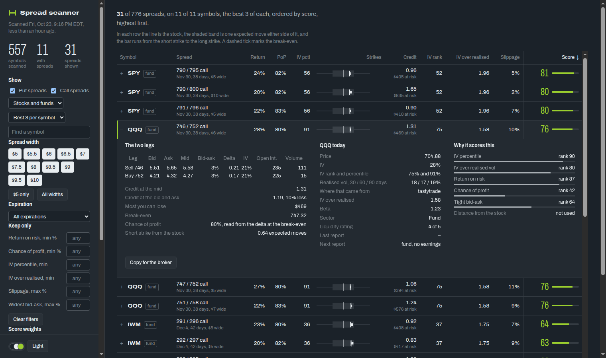

<div align="center">

# Spread Scanner

**Which credit spreads are worth opening today, and how likely are their options to be overpriced?**

Scans the whole optionable market, or a list you give it, for bull put and bear call spreads, drops the names that are about to report earnings, keeps the options that trade tightly, and ranks what is left by how rich implied volatility is against what the stock actually does.


[What it uses](#what-it-uses) · [How it picks spreads](#how-it-picks-spreads) · [Configuration](#configuration) · [Using it](#using-it) · [The report](#the-report) · [Running it on a schedule](#running-it-on-a-schedule) · [Status](#status) · [Data sources](docs/DATA_SOURCES.md)



</div>

## What it uses

| What | Service | Needed? |
|---|---|---|
| Runtime | Node.js 26, which runs the TypeScript directly | Yes |
| IV rank and percentile, option chains, quotes, greeks, open interest, next earnings date | [tastytrade API](https://developer.tastytrade.com/) (OAuth, read-only scope; real-time data needs a funded account) | Yes |
| Earnings dates, daily price history | [Financial Modeling Prep](https://site.financialmodelingprep.com/) (the free tier is 250 calls a day) | Yes |
| Type checking | `typescript`, a dev dependency | Only for `npm run typecheck` |

There is no Schwab dependency. [docs/DATA_SOURCES.md](docs/DATA_SOURCES.md) has what each source returns, its limits, and the traps in the data.

## How it picks spreads

**Which underlyings.** With no list given, the scan starts from every optionable stock and fund (about 6,000, from tastytrade's catalogue) and narrows by what one metrics call already says, before any chain is fetched:

1. tastytrade's **liquidity rating** of at least `universe.minLiquidityRating` (4 by default, about 550 names). It is the cheapest stand-in for the bid-ask rule below: most names under it fail that rule anyway.
2. The **earnings rule**, below.
3. The richest `universe.maxNames` (250 by default) by IV percentile and IV over realised volatility, so the expensive calls go to the names the ranking would favour. Names with no historical volatility are judged on the percentile alone.

The scan prints and saves the counts at each step (`funnel`) rather than listing thousands of names. A list given with `--symbols` or `--symbols-file` is scanned exactly, never thinned.

For each underlying that is left, per expiration in the DTE window:

1. **Earnings** (`src/earnings.ts`). The last report at least `minDaysSinceLast` days ago and the next at least `minDaysUntilNext` away. An unknown date fails. When sources disagree the nearer next date wins.
2. **Which contracts to quote** (`src/strikes.ts`). Neither broker filters a chain by delta, so the delta range is turned into a strike range from the spot and the volatility the options actually trade at, and only those contracts (about 25 a symbol, against 74 for a broad pull) are requested. That volatility is read from one probe contract per side and expiration, because the IV index is an at-the-money figure and a wing can sit far from it: SPY's index was 19.8% while its calls at 0.2 delta traded near 13%.
3. **Pairing** (`src/spread.ts`). A short leg needs an absolute delta in `delta.min..delta.max`, must be out of the money, and every leg used must have a bid-ask within `maxLegSpreadPct` of its mid and an open interest or a day's volume of at least `minLegActivity`. Every usable long leg between `width.min` and `width.max` dollars past it is a candidate, so one short strike can give several spreads. The report filters by width.
4. **What it is worth if you exit early** (`src/outcome.ts`). The chance of profit below is for holding to expiration, which a trade with a profit target and a stop never does. So every candidate is also simulated under the exit rules in `outcome`: 800 paths of the stock (`outcome.paths`), both legs repriced several times a day (`outcome.intraday`), a resting order at the profit target that can fill at any of those steps, a stop checked only at each close, and a time exit before expiration. It reports the share of runs that end in a profit, the win rate at which the average win and loss cancel (the break-even win rate), and the average result in dollars. A win rate above its break-even means the structure pays.
5. **Odds and cost.** Credit at the mid and at the natural price, max risk, return on risk, and a chance of profit read from the delta at the break-even (not `1 - |delta| + credit / width`, which counts the credit twice).

## Configuration

`config/default.json` holds generic defaults. Put your own numbers in `config/local.json`, which is git-ignored and merged over the defaults key by key (arrays are replaced, not merged).

| Key | Meaning |
|---|---|
| `dte.min`, `dte.max` | Days-to-expiration window |
| `delta.min`, `delta.max` | Absolute delta of the short leg |
| `width.min`, `width.max` | Spread widths in dollars; every available width in the range is a candidate |
| `maxLegSpreadPct` | Largest (ask - bid) / mid, in percent, for any option used |
| `minLegActivity` | Smallest open interest or day's volume, whichever is larger, for any option used. A spread with a thin leg is never a candidate, so it takes no place in the ranking |
| `earnings.minDaysSinceLast`, `earnings.minDaysUntilNext` | The earnings rule |
| `universe.minLiquidityRating`, `universe.maxNames` | The funnel for a scan with no list: the lowest tastytrade liquidity rating (1 to 5) and the most names that go on to chains and quotes |
| `outcome` | The exit rules the simulated win rate, break-even win rate and expected P&L assume: `takeProfit` (a fraction of the credit), `stopLoss` (a fraction of the most you can lose), `exitDte` (days before expiration), `fillShare` (how far from the mid toward the worst price each fill lands), `ivDecay` (how much of each option's implied volatility drains away by the exit), `volEdge` (how much of the stock's path is drawn at realised instead of implied volatility; 0 trusts the options), `paths` (how many simulated paths, at least 100) and `intraday` (price steps a day; the target can fill at any step, the stop only at the last) |
| `ranking.weights` | The weight of each component in the score (see [Ranking](#ranking)); the report's sliders start here |
| `display.filters` | Where the report's "Keep only" fields start, and what "Reset to defaults" returns them to, for example `{ "minIvPercentile": 30 }`. Names: `minReturn`, `minPop`, `maxSlippage`, `maxLegSpread`, `minIvPercentile`, `minIvOverHv`, `minLegActivity` (each leg's open interest or today's volume, whichever is larger). They only hide rows on the page; the scan keeps everything |
| `display.spreadBookUrl` | spread-book's report, e.g. `https://spreads.example.com/`. When set, an opened row gets a "Try in spread-book" button that opens the report with the spread added as a trial trade (one contract, at the mid). The URL is embedded in the page, so keep it in `config/local.json`. A scan embeds its config, so it takes effect from the next scan |
| `display.tickets` | `true` shows the report's **Paper trades** section: with the ticket token saved in the browser, an opened row gets a "Paper trade" button that sends the spread to spread-book as a paper trade (one contract, filled at live quotes when spread-book acts, in the regular session only). Needs the stack's ticket path, `ENABLE_TICKETS` (docker/README.md). Takes effect from the next scan |
| `display.timeZone` | Zone for the scan time shown in the report (default `America/Denver`); dates are unaffected |
| `strikeSelection` | Slack and margins for choosing which strikes to quote. `rateFromSofr` (on by default) takes the risk-free rate from the latest SOFR, published free by the New York Fed and cached for the day; `rate` is the fallback if that cannot be fetched. The rate each run used is saved in it |

## Using it

```bash
# credentials go in a file outside the repository (see "Credentials" below)
node src/cli.ts scan                                  # every optionable name, through the funnel
node src/cli.ts scan --symbols SPY,QQQ,IWM,GLD        # or --symbols-file watchlist.txt: exactly those
node src/cli.ts validate                              # once runs are weeks old
```

`scan` prints what it dropped and why, then the best candidates (the best three per underlying by default), and writes the whole ranked result to `runs/`. A scan from the whole market takes about 25 seconds, most of it the chain listings, which are cached for the day.

### The report

```bash
node src/cli.ts report        # the latest scan in runs/ -> report/index.html
```

One self-contained page: open `report/index.html` straight from disk, no server. The scan is embedded in it.

- **Every row has a strike ruler.** The line is the stock, the shaded band is one expected move either side of it (the short option's own IV over the days left, the volatility its delta was computed with), and the bar runs from the short strike to the long strike. Puts sit left of the stock and calls right, on one shared scale of plus or minus 1.5 expected moves (an arrow marks a strike beyond it), so rows compare at a glance. A short strike at 0.15 to 0.25 delta sits at roughly 0.7 to 1 expected move by construction, so most spreads land inside the band.
- **Filters** for a symbol search, side, spread width (a chip for each width the scan found), expiration, stocks or funds, and minimums or maximums on return, chance of profit, IV percentile, IV over realised vol, slippage and the widest bid-ask. The list shows the best three of each symbol unless you ask for more.
- **Every spread links to OptionStrat.** The strikes in a row, and an "Open in OptionStrat" button in the opened row, open that exact spread in OptionStrat's builder, always in the same tab, so the next spread replaces the last. The link names the strategy, the underlying and both legs; OptionStrat opens it in whatever view (table or graph) you last chose there, since that is kept in your own browser, not in the link.
- **Try it in spread-book.** With `display.spreadBookUrl` set, an opened row's "Try in spread-book" button opens spread-book's report with the spread added as a trial trade: one contract at the mid, in every total, never saved. It travels in the URL fragment, so it never reaches a server, and further tries land in the same spread-book tab and stack there.
- **Paper trade it.** With `display.tickets` on and the ticket token saved in the rail's **Paper trades** section, an opened row's "Paper trade" button sends the spread to spread-book, which opens it as a paper trade at live quotes within a few seconds and says so under the button. spread-book refuses it outside the regular session or when it arrives stale. Without a saved token there is no button that acts. The path is in [docker/README.md](docker/README.md#paper-trades-optional).
- **A ticker opens its chart.** Clicking a symbol opens TradingView's daily chart, with the 20, 50, 100 and 200 day moving averages, in a panel over the page (Escape closes it). A ctrl- or middle-click opens tradingview.com in a tab instead.
- **Weight sliders** re-rank the list as you move them. Click anywhere else on a row (or press Enter on it) to open it and see its legs with their greeks and the net greeks of the spread, the underlying's figures and how each component ranked. Hover a column title for what it means.
- **A palette picker and a Light/Dark button**, the same control as equity-watch's.

The page works down to a 320px phone. Every column is always there: when the table is wider than its room it scrolls sideways, with the symbol and the score pinned either side, and the opened row stays in view while it does.

### Ranking

Each candidate gets six component ranks and a weighted average of them (weights in `ranking.weights`):

| Component | Level | Better when |
|---|---|---|
| `ivPercentile` | underlying | IV is high against its own year |
| `ivOverHv` | underlying | IV is high against recent realised volatility (the average of the 30, 60 and 90-day figures) |
| `returnOnRisk` | spread | the credit at the natural price is large against the money at risk |
| `pop` | spread | the chance of profit, from the delta at the break-even, is high |
| `legSpread` | spread | the worse leg's bid-ask is tight |
| `distance` | spread | the short strike is far from the stock, in expected moves (weight 0 by default) |

Underlying-level components are ranked across underlyings, so a name with forty spreads does not count forty times. **The weights are a first guess.** That is what `validate` is for: every run keeps its inputs, and once runs are a few weeks old it compares IV with the volatility that followed, and each score quintile with how its spreads held up at the exit date.

### Credentials

`~/.config/spread-scanner/credentials.env` (or `--credentials FILE`, or environment variables):

```
TT_CLIENT_SECRET=...
TT_REFRESH_TOKEN=...
FMP_API_KEY=...
```

Create a tastytrade OAuth client with the `read` scope only; the scanner never places orders.

## Running it on a schedule

`docker/` runs the scan four times every weekday in a container, saves each ranked result to `runs/` (the log `validate` reads), rebuilds the report and publishes it:

```bash
node src/cli.ts publish      # upload report/ to S3 (S3_BUCKET, AWS_ACCESS_KEY_ID, AWS_SECRET_ACCESS_KEY; AWS_REGION defaults to us-east-1)
```

`infra/cloudformation.yaml` creates the site: a private S3 bucket, CloudFront with a certificate, a Route 53 alias on your domain, an optional password prompt, and a publisher that can only write the report's own files (its key in Secrets Manager, not the stack's outputs). With `EnableTickets` it also adds the Paper trade button's back end: `/api/tickets` (a Lambda that checks a token), an SQS FIFO queue, and a key for spread-book's watcher that can only take tickets and write their results. [docker/README.md](docker/README.md) has the setup, from the stack to the first scheduled run. The publisher signs its own requests, so it adds no dependency.

## Status

Early. Written and tested: the earnings rule, strike selection, spread pairing, the tastytrade and FMP providers, the scan, the ranking, the validation, the browser report, the container and stack that run and publish it, and the hand-offs to spread-book (trial trades, and paper trades through the ticket queue). The weights are still a guess until `validate` has weeks of runs to check them against.

## Development

Node 26 runs the TypeScript directly: no build step and no runtime dependencies. The ticket Lambda is inline in `infra/cloudformation.yaml`; `test/stack.test.ts` runs it from the template.

```bash
npm ci
npm test            # node --test
npm run typecheck   # tsc, noEmit
```

Related: spread-book, a separate project, manages spreads once they are open. This project finds them, and hands a spread over either as a trial trade (in the link) or as a paper trade (through the ticket queue).

## Disclaimer

Nothing here is investment advice. Option data can be stale or wrong; check a trade with your broker before acting on it.
